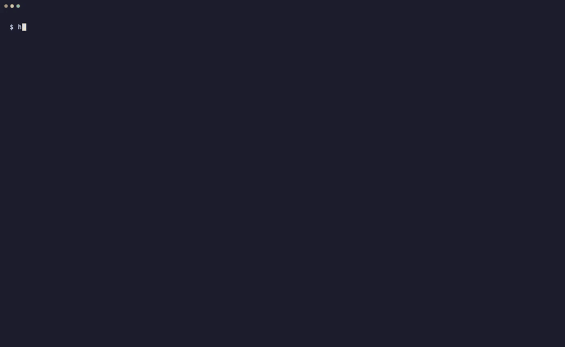

# k8s-agent-sandbox

A sandboxed AI agent that triages Kubernetes alerts. SigNoz watches the cluster. When an alert fires, the triage controller records an `Incident`. The coordinator gives the triage step its own short-lived identity and starts it, and the triage controller runs it in a [kubernetes-sigs/agent-sandbox](https://github.com/kubernetes-sigs/agent-sandbox) Sandbox under gVisor. A Claude-powered agent inside investigates with read-only tools and reports the likely cause. Then, if a `RemediationSkill` applies, a second sandboxed agent proposes one fix (restart or scale the alert's workload) or declines, and the executor performs it once the checks and, where required, a human approve it.

```
SigNoz alert ──webhook──► triage-controller ──► Incident ──► coordinator
                                  │                               │ SA + Role + RoleBinding triage-<run>
                                  │◄──────── TriageRun ───────────┘ (revoked when the run ends)
                                  │──creates──► Sandbox (gVisor, runs as triage-<run>)
                                  ▲                          │ triage-agent
                                  └──────── report ──────────┤
                                                             ├──► signoz-mcp  (logs, traces, metrics, alerts)
                                                             ├──► k8s-mcp     (read-only cluster state)
                                                             └──► llm-proxy ──► egress-gateway ──► api.anthropic.com

triage done ──► coordinator ──► Remediation (SA + Role remediate-<incident>, pinned to the workload)
                                  └─► triage-controller ──► Sandbox (remediation agent: propose_action / no_action)
                                        └─► executor: skill + RBAC check, approval, cooldown ──► restart / scale
```

The sandbox has no internet access and no API keys. It runs as its run's own ServiceAccount, `triage-<run>`, with only a pod-bound, audience-scoped token. The controller and llm-proxy verify the token and check RBAC: the run's Role allows `get`/`update` on its own `triagerun` and `use` on one model, nothing else. The coordinator creates that identity just before the run and deletes it right after, which also kills the token. It is the only component allowed to create RBAC objects, and an admission policy keeps what it creates step-shaped (see [ADR 0001](docs/adr/0001-coordinator-separate-process.md)). The llm-proxy holds the Anthropic key and enforces a request policy; the egress gateway is the only workload allowed to leave the cluster, and only to allowlisted hosts. Calico enforces the NetworkPolicies, including egress.

Everything runs on a local kind cluster. See [docs/architecture.md](docs/architecture.md) for the design and security model.

## Demo

One incident on the kind cluster, from alert to fix: the coordinator gives each step its own pinned identity, the remediation agent runs in a gVisor sandbox and proposes a rollout restart, the executor checks it and performs it, and both identities are revoked. The triage report is injected (the local model used here is too small to finish triage reliably); every step after it is live.



To run it yourself after `./setup.sh` and `./setup.sh demo`: `hack/demo/remediation-demo.sh`, or `vhs hack/demo/remediation-demo.tape` to record it again.

## Requirements

- Docker (tested with OrbStack on Apple Silicon) with about 14 GiB of memory for the VM, or about 8 GiB with `PROFILE=lean`
- `kind`, `kubectl`, `helm`, `jq`, `curl`, `openssl`
- An Anthropic API key, or an OpenAI-compatible LLM server on this machine (see [Without an Anthropic key](#without-an-anthropic-key))

SigNoz is installed with [Foundry](https://github.com/SigNoz/foundry) (`deploy/signoz/casting.yaml`, installation `main`, ClickHouse Keeper). `setup.sh` downloads a pinned, checksum-verified `foundryctl` into `.cache/`.

## Setup

```sh
./setup.sh
```

The script is safe to re-run; each step skips work that is already done. `./setup.sh --list` shows the steps, and `./setup.sh <step>...` runs only those.

### The Anthropic API key

The `llm-secret` step pauses and asks you to create the key Secret. Run this in another terminal, paste the key (it is not echoed), then press Enter in the setup terminal:

```sh
read -rs ANTHROPIC_API_KEY && \
kubectl --context kind-agent-sandbox -n llm-proxy create secret generic anthropic-api-key \
  --from-literal=ANTHROPIC_API_KEY="$ANTHROPIC_API_KEY"
```

Only the llm-proxy reads the key; sandboxes never see it. Never commit it.

### Without an Anthropic key

The llm-proxy can translate the agent's Anthropic requests to an OpenAI-compatible server running on your machine, such as `mlx_lm.server`:

```sh
PROFILE=lean LLM_MODE=local ./setup.sh
```

- `PROFILE=lean` runs a single node with tight resource limits, so the cluster fits in about 8 GiB next to the model.
- `LLM_MODE=local` skips the key prompt, points the egress gateway at `host.docker.internal:${LOCAL_LLM_PORT:-8000}`, and grants agents the model alias `local-qwen`. It also runs one triage at a time with a 30-minute timeout and offers the agent a smaller tool set.

Small local models are weak at this task: they stop early and invent evidence. The agent sends such reports back (see [Report review](#report-review)), but expect `Incomplete` reports. When a key arrives, create the Secret and run `./setup.sh llm-secret llm-proxy triage` without `LLM_MODE`.

### Egress

| Workload | May reach |
|---|---|
| triage sandboxes | DNS, triage-controller, signoz-mcp, k8s-mcp, llm-proxy |
| llm-proxy | DNS, egress-gateway |
| egress-gateway | DNS, internet on 443, and it only opens tunnels to `api.anthropic.com` and `hooks.slack.com` |
| triage-controller | DNS, Kubernetes API, egress-gateway |
| signoz-mcp | DNS, SigNoz |
| k8s-mcp | DNS, Kubernetes API |

To allow another destination, add a virtual host to the allowlist in `deploy/egress/manifests.yaml` and bump the `config-version` annotation. `./setup.sh egress triage` re-checks all of the above from probe pods.

### Try it

```sh
./setup.sh demo
```

This deploys `workloads/payments-api`, which crashloops because its database host does not resolve. Within a few minutes SigNoz fires the `K8s warning events` alert, a sandboxed agent investigates, and the script prints the report. Each run calls the Anthropic API.

Reports appear in the controller log and in `slack-sink`, a small in-cluster stand-in for a Slack incoming webhook that shows the messages it receives on a web page:

```sh
kubectl --context kind-agent-sandbox -n alert-triage port-forward svc/slack-sink 8090:8080   # open http://localhost:8090
```

To post to real Slack instead, put your webhook URL in the `alert-triage/slack-webhook` Secret (key `url`) and restart `deployment/triage-controller`. The egress gateway already allows `hooks.slack.com`, and `setup.sh` leaves a URL you set alone.

```sh
kubectl --context kind-agent-sandbox get incidents,triageruns -A
kubectl --context kind-agent-sandbox -n alert-triage port-forward svc/triage-controller 8081:8080
curl -s localhost:8081/v1/runs | jq
```

Incidents, runs, and remediations are custom resources, so they survive controller restarts; finished ones are deleted after a day (`INCIDENT_RETENTION` on the coordinator).

## Triage skills

The agent's investigation playbooks are `TriageSkill` custom resources, one per skill, in `skills/`. Add a file and `kubectl apply` it; the next triage run uses it. See [docs/skills.md](docs/skills.md).

```sh
kubectl --context kind-agent-sandbox get triageskills
```

## Remediation

After a successful triage the coordinator looks for a `RemediationSkill` that matches the alert and allows an action on its workload in a namespace opened to remediation (`REMEDIATION_NAMESPACES`, default `workloads`). The starter skill is `deploy/remediation/skills.yaml`. The remediation agent proposes one action or declines; restarts run at once, scaling waits for a human:

```sh
kubectl --context kind-agent-sandbox get remediations -n agent-sandboxes
kubectl --context kind-agent-sandbox -n agent-sandboxes patch remediation <name> --type merge -p '{"spec":{"approval":"Approved"}}'
```

`REMEDIATION_MODE=dry-run ./setup.sh remediation` records actions without doing them; `off` rejects them all. Details: [docs/architecture.md](docs/architecture.md#remediation), [ADR 0003](docs/adr/0003-remediation-executor-in-triage-controller.md).

## Report review

The agent checks each report before it accepts it, and sends it back to the model when:

- a next step is something the agent could check itself with its tools (it names a tool, or asks to check logs, events, status, images, metrics, or traces),
- evidence cites a tool the agent never called in this run, or
- evidence links to a URL that no tool returned.

After two rejections the agent accepts the report, removes the invented links, and sets `incomplete`, which the Slack message shows as a warning. Code: `internal/agent/review.go`.

## Layout

```
api/v1alpha1            Incident, TriageRun, Remediation, RemediationSkill custom resource types
cmd/triage-controller   webhook → Incident, runs TriageRuns and Remediations in sandboxes, agent API, executor
cmd/coordinator         moves Incidents through steps; creates and revokes per-step identities
cmd/triage-agent        the agent that runs inside each sandbox (AGENT_MODE=remediate for remediation)
cmd/llm-proxy           holds the API key, enforces the Anthropic request policy, translates to OpenAI for local models
cmd/slack-sink          local Slack stand-in that shows the reports it receives
internal/               agent loop, Claude + MCP adapters, controller, coordinator, sandbox, remediation, skills, report schema
skills/                 TriageSkill custom resources, one per playbook
deploy/                 kind, Calico, SigNoz (Foundry casting), k8s-infra, MCP servers, egress, llm-proxy, triage, demo
docs/                   architecture, setup details, ADRs
setup.sh                end-to-end setup
```

## Development

Every binary is a [cobra](https://github.com/spf13/cobra) command. Each flag falls back to an environment variable of the same name (`--dedup-window` reads `DEDUP_WINDOW`), which is how the Deployments and sandboxes configure them; a flag on the command line wins. Credentials (`ANTHROPIC_API_KEY`, `SLACK_WEBHOOK_URL`) are env-only so they never appear in process listings. `go run ./cmd/<binary> --help` lists the flags.

```sh
go test -race ./...
go vet ./...
./setup.sh images     # rebuild and reload the images into kind

# after changing api/v1alpha1: regenerate deepcopy and the CRDs in deploy/crds/
go tool controller-gen object paths=./api/...
go tool controller-gen crd paths=./api/... output:crd:artifacts:config=deploy/crds
```
